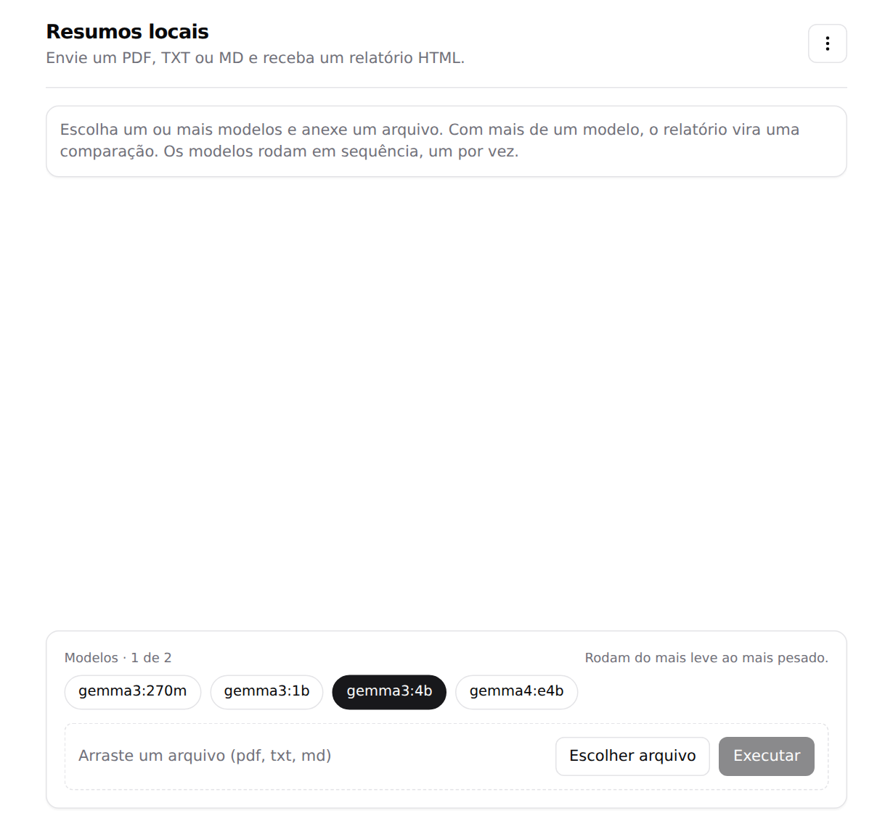
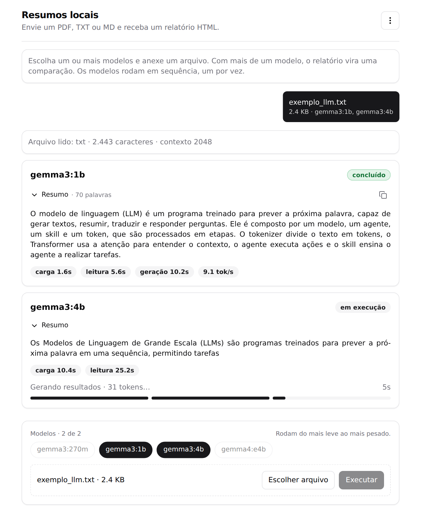
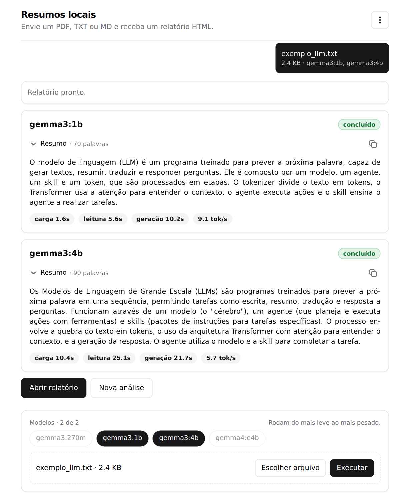
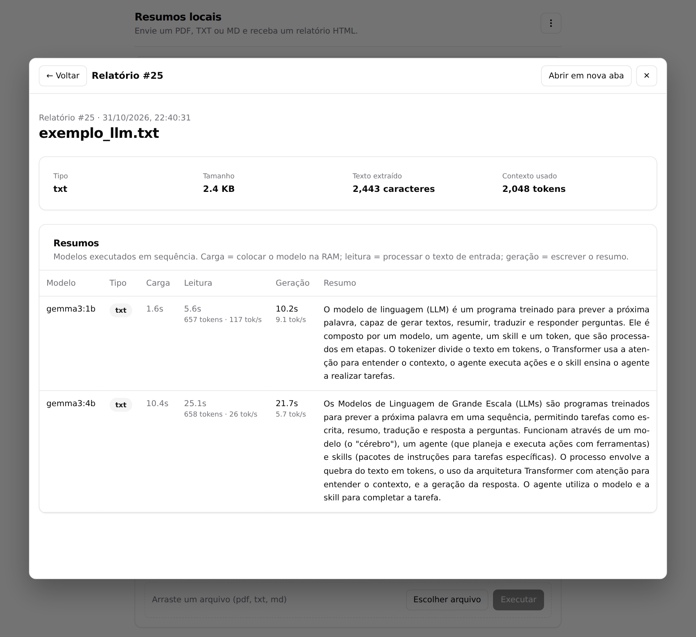
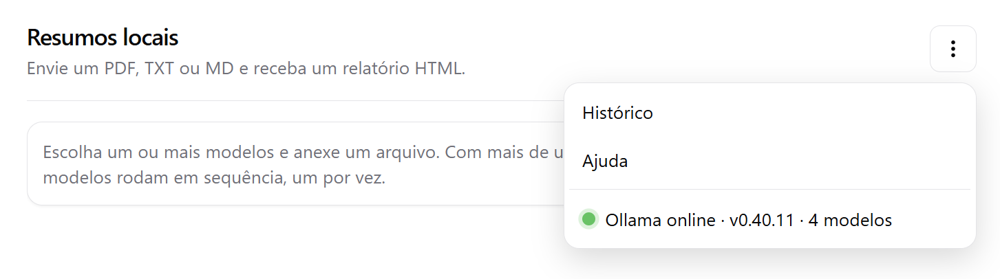
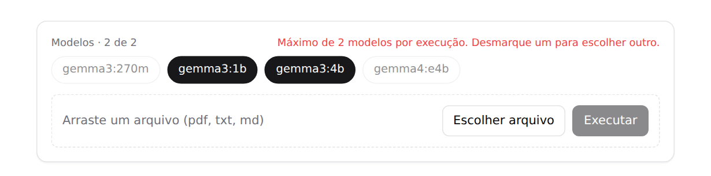
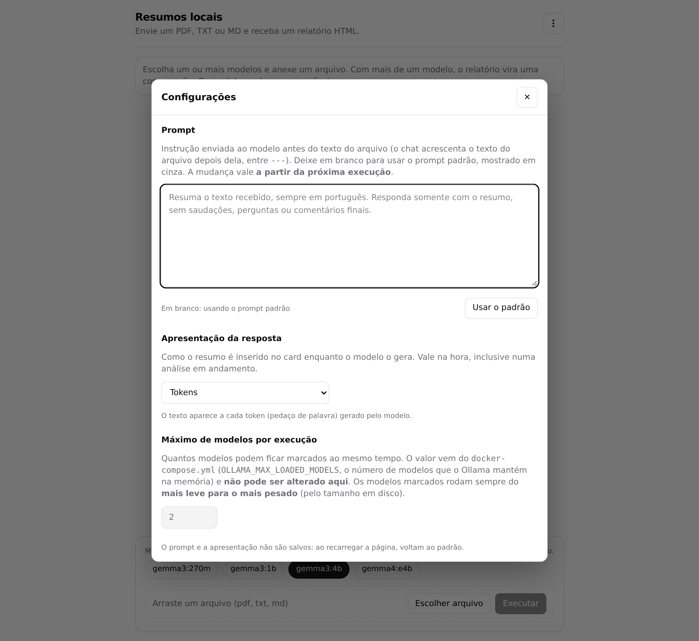
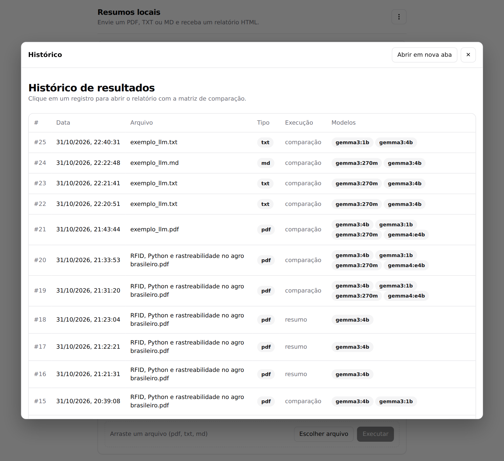
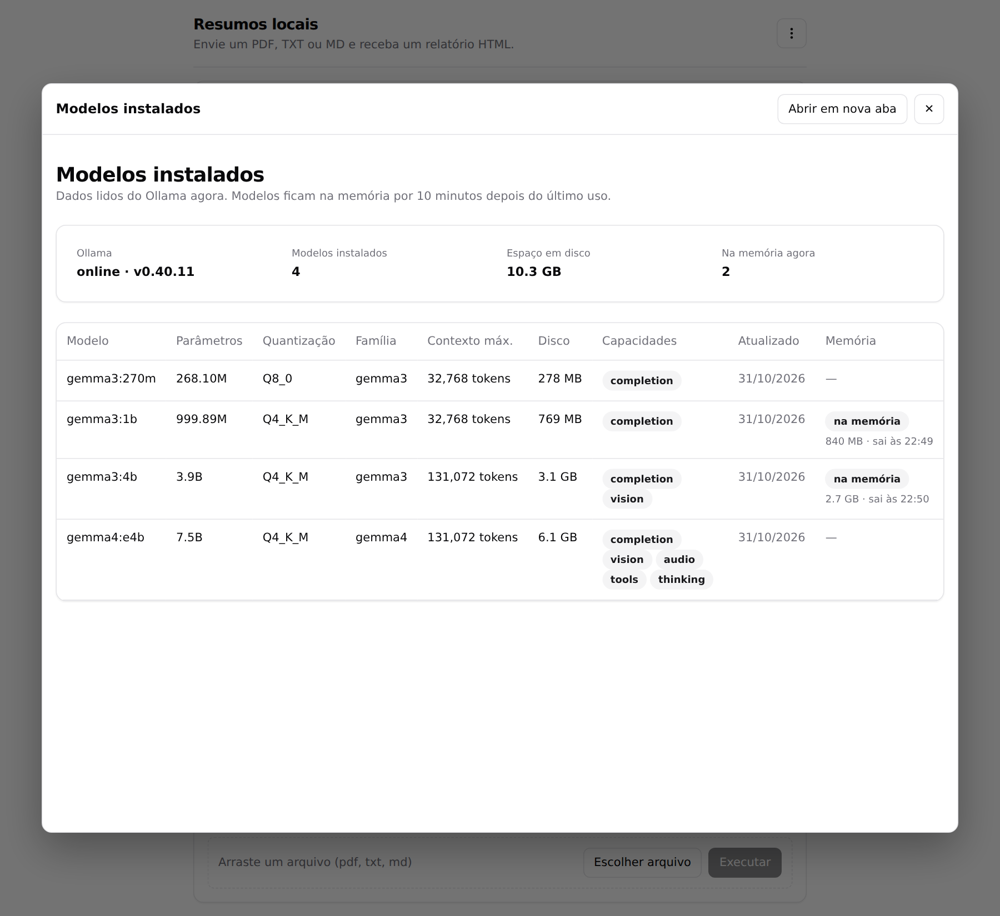
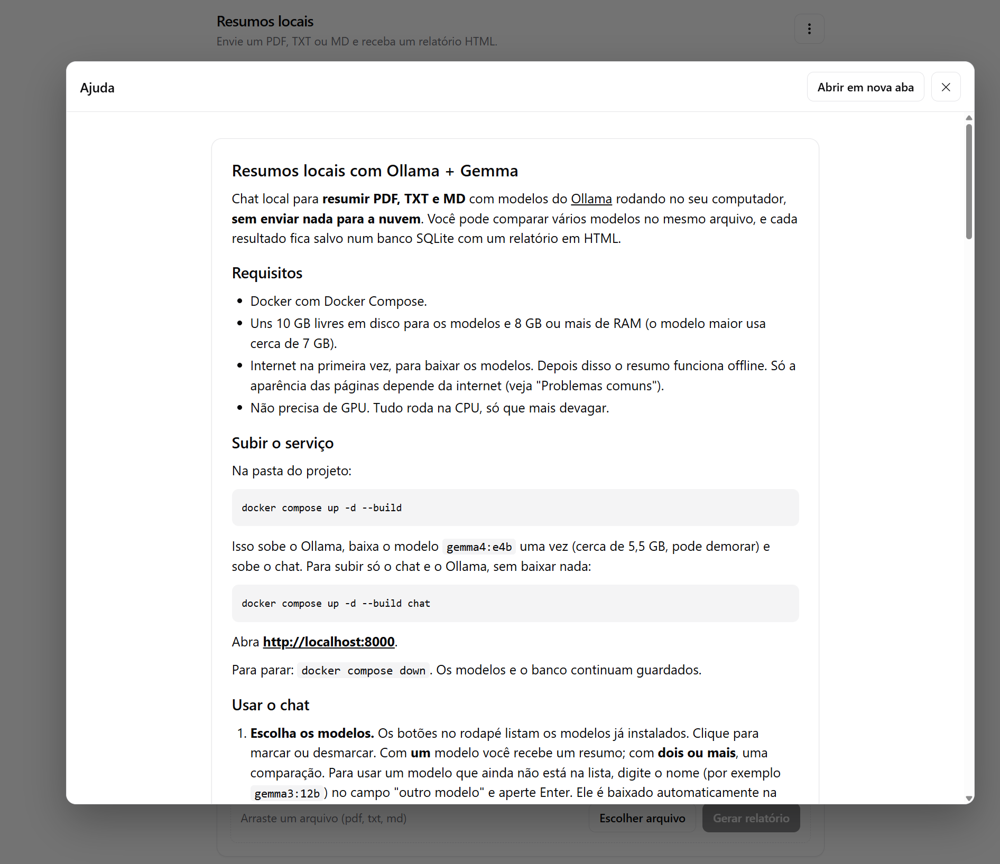

# Resumos locais com Ollama + Gemma

Chat local para **resumir PDF, TXT e MD** com modelos do [Ollama](https://ollama.com) rodando no seu computador, **sem enviar nada para a nuvem**. Você pode comparar vários modelos no mesmo arquivo, editar o prompt, escolher como o texto aparece no card, e cada resultado fica salvo num banco SQLite com um relatório em HTML.

## Requisitos

- Docker com Docker Compose.
- Uns 12 GB livres em disco para os quatro modelos (ocupam cerca de 10 GB) e 8 GB ou mais de RAM (o modelo maior usa cerca de 7 GB).
- Internet na primeira vez, para baixar os modelos. Depois disso o resumo funciona offline. Só a aparência das páginas depende da internet (veja "Problemas comuns").
- Não precisa de GPU. Tudo roda na CPU, só que mais devagar.

## Subir o serviço

Na pasta do projeto:

```bash
docker compose up -d --build
```

Isso sobe o Ollama, **baixa os quatro modelos usados pelo chat** (`gemma3:270m`, `gemma3:1b`, `gemma3:4b` e `gemma4:e4b`) e sobe o chat. Numa instalação nova são cerca de 10 GB, então **demora**. O chat não espera o download: ele lista cada modelo conforme fica pronto, então recarregue a página. Acompanhe com `docker compose logs -f pull-model`. Em uma máquina que já tem os modelos, a verificação leva alguns segundos.

Para baixar outros modelos, ou só alguns, defina a variável `MODELS` (uma lista separada por espaços), na linha de comando ou num arquivo `.env` ao lado do `docker-compose.yml`:

```bash
MODELS="gemma3:1b gemma3:4b" docker compose up -d --build
```

Se algum nome não existir, o download para ali e o `pull-model` termina com erro (veja os logs). Para subir só o chat e o Ollama, sem baixar nada:

```bash
docker compose up -d --build chat
```

Abra **http://localhost:8000**.

Para parar: `docker compose down`. Os modelos e o banco continuam guardados.

## Usar o chat

1. **Escolha os modelos.** Os botões no rodapé listam os modelos já instalados, **do mais leve ao mais pesado** (pelo tamanho em disco). Clique para marcar ou desmarcar. Com **um** modelo você recebe um resumo; com **dois**, uma comparação. Você pode marcar **no máximo dois** modelos por execução: esse limite vem do `docker-compose.yml` (veja "Máximo de modelos por execução" abaixo). O contador ao lado de "Modelos" mostra quantos estão marcados (por exemplo, "· 1 de 2"); ao atingir o limite, os outros botões ficam esmaecidos, e tentar marcar mais um mostra um aviso em vermelho por alguns segundos. Desmarque um para escolher outro. Para usar um modelo que ainda não está na lista, instale-o antes (por exemplo `docker exec ollama ollama pull gemma3:12b`) e recarregue a página.

   **Os modelos rodam sempre do mais leve para o mais pesado**, qualquer que seja a ordem em que você os marcou. Se você marcar o `gemma3:4b` e depois o `gemma3:1b`, o `1b` roda primeiro. A mensagem do arquivo na conversa, os cartões e as linhas do relatório seguem essa mesma ordem.
2. **Anexe o arquivo.** Clique em "Escolher arquivo" ou arraste o arquivo para a área tracejada. Formatos aceitos: **PDF, TXT e MD**, até 20 MB.
3. **Clique em "Executar".** O arquivo aparece como mensagem sua, e cada modelo ganha um cartão que mostra o resumo sendo escrito ao vivo, dentro do próprio cartão. Os modelos rodam **um de cada vez**; os que ainda não começaram aparecem como "na fila".
4. **Acompanhe as etapas** de cada modelo. Cada análise passa por três etapas, e o rodapé do cartão mostra a etapa atual, um cronômetro e uma barra dividida em três trechos (carga, leitura e geração):
   - **Carregando modelo:** o Ollama coloca o modelo na memória (se o modelo ainda não existe, antes disso aparece "Baixando modelo" com o percentual real do download);
   - **Executando leitura:** o modelo processa o texto do arquivo;
   - **Gerando resultados:** o resumo é escrito ao vivo, já com a formatação em Markdown.

   Os trechos da barra enchem conforme as etapas terminam. Em carga e leitura ela fica em movimento contínuo, porque não há como saber quanto falta. Na geração ela avança conforme os tokens são escritos, mas isso é uma **estimativa** (o tamanho final do resumo não é conhecido), e por isso ela não passa de 95% antes de a análise concluir. Ao terminar, a barra completa e some, e o selo do cartão vira **concluído** (verde).

   **Os pills de tempo** (carga, leitura, geração e tokens por segundo) aparecem um a um, **depois que cada etapa termina**. **Passe o mouse** sobre um pill (ou foque nele com `Tab`) para ver um tooltip explicando o que ele mede; em telas de toque, toque no pill. O tooltip fecha ao tirar o mouse, tocar fora ou apertar `Esc`.

   **O resumo é recolhível.** Dentro do cartão, o botão **Resumo** (com a seta) recolhe e expande o texto, o que ajuda quando ele é longo. Depois que o modelo conclui, aparece ao lado o ícone de **copiar**, que leva o texto do resumo para a área de transferência (o ícone vira um ✓ por instantes para confirmar).
5. **Abra o relatório.** Ao terminar surge o botão "Abrir relatório", que mostra o relatório numa janela (modal) sobre o chat.
6. **Comece outra.** O botão **Nova análise**, ao lado de "Abrir relatório", limpa a conversa e o arquivo escolhido e mantém os modelos marcados.

O chat avisa quando o arquivo não pode ser usado: tipo errado, PDF escaneado (sem texto), arquivo vazio, binário disfarçado de texto ou maior que o limite.

## Menu, configurações, histórico e ajuda

O botão de **três pontinhos** (⋮), no topo do chat, abre um menu com **Histórico**, **Configurações**, **Ajuda** e o **status do Ollama**. Os três primeiros abrem numa janela (modal) sobre o chat. O status mostra uma bolinha **verde** (online, com a versão do Ollama) ou **vermelha** (offline).

O status se mantém **sempre atualizado** com o [htmx](https://htmx.org): a página consulta o Ollama ao carregar, **a cada 10 segundos** (enquanto a aba está visível), ao voltar para a aba e ao abrir o menu. Se o próprio chat sair do ar, a bolinha fica vermelha com "Servidor do chat inacessível".

**Configurações.** O item **Configurações** abre uma janela com três itens: dois editáveis (o prompt e a apresentação da resposta) e um informativo (o máximo de modelos por execução). O que você edita **não é salvo**: os valores vivem só na página, e ao recarregar tudo volta ao padrão.

**1. Prompt.** É o texto da instrução enviada ao modelo antes do conteúdo do arquivo (o chat acrescenta o texto do arquivo depois dela, entre `---`). Para ajustar o prompt sem mexer no código:

- o campo começa **em branco** e mostra, em cinza (como *placeholder*), o **prompt padrão** do projeto. Em branco, o padrão é usado;
- digite o seu prompt e ele vale **já na próxima execução**, sem reiniciar nada. O botão **Usar o padrão** limpa o campo;
- cada execução usa o prompt que estava no campo **no momento em que você clicou em Executar**, para todos os modelos daquela comparação, de modo que eles sejam comparados com a mesma instrução. Mudar o texto durante uma análise vale para a próxima, e a janela avisa isso;
- quando o prompt é personalizado, a mensagem do arquivo na conversa mostra "prompt personalizado";
- o limite é de 4000 caracteres.

**2. Apresentação da resposta.** Define **como o resumo é inserido no card** enquanto o modelo o gera. Vale na hora, inclusive numa análise que já está rodando, porque só muda o que aparece na tela, e não o que o modelo recebe ou produz:

| Opção | O que o card mostra durante a geração |
|---|---|
| **Tokens** (padrão) | O texto cresce a cada token (pedaço de palavra) gerado. |
| **Palavras** | Só palavras completas: uma palavra aparece quando termina. |
| **Parágrafos** | Só parágrafos completos: um parágrafo aparece quando o modelo o fecha com uma linha em branco. Se o modelo escrever um parágrafo só, ele aparece no fim. |
| **Texto Completo** | Nada do texto até a geração terminar; então ele aparece inteiro. Enquanto isso, o rodapé do card mostra a etapa e o cronômetro. |

Como em **Parágrafos** e **Texto Completo** o texto fica retido e o card pareceria parado, nesses dois modos aparece um **ícone de carregamento (um círculo girando) no centro do card** enquanto o modelo trabalha, da carga até concluir. Em Parágrafos ele continua visível mesmo depois que os primeiros parágrafos aparecem, porque ainda faltam outros. O ícone aparece ou some na hora se você trocar a opção durante a análise.

Quando o modelo conclui, o card mostra sempre o texto inteiro, qualquer que seja a opção. O relatório também sempre mostra o texto completo.

**3. Máximo de modelos por execução.** Mostra, num campo **bloqueado** (não dá para editar), quantos modelos podem ficar marcados ao mesmo tempo. O valor **vem do `docker-compose.yml`**: é o mesmo `OLLAMA_MAX_LOADED_MODELS`, o número de modelos que o Ollama mantém na memória (aqui, **2**). O compose define o valor uma única vez e o entrega ao Ollama e ao chat; para mudá-lo, edite o compose (ou use `OLLAMA_MAX_LOADED_MODELS=1 docker compose up -d`) e recrie os serviços. O chat respeita o limite nos botões de modelo, e o servidor também recusa uma requisição com mais modelos do que o permitido.

**Clicar no item de status:**

- com o Ollama **online**, abre um modal com os **modelos instalados**: parâmetros, quantização, família, contexto máximo, capacidades (por exemplo `completion`, `vision`, `thinking`), tamanho em disco, data de atualização e se o modelo está **na memória** agora (com o tamanho e a hora em que será descarregado). No topo há a versão do Ollama, o total de modelos, o espaço em disco ocupado e quantos estão na memória;
- com o Ollama **offline**, o clique tenta consultar de novo.

**Fechar as janelas.** Em todas, use o ✕, a tecla `Esc` ou clique fora. Histórico, relatório, modelos instalados e ajuda também têm o botão "Abrir em nova aba", que abre a mesma página fora do chat.

O **Histórico** lista todos os resultados, do mais recente para o mais antigo: número, data, arquivo, tipo, se foi resumo ou comparação e os modelos usados. **Clique em uma linha** para abrir o relatório daquele registro dentro da mesma janela, com o botão "← Voltar" para retornar à lista.

## Telas

As capturas foram feitas com o arquivo `samples/exemplo_llm.txt` (um texto curto sobre LLMs, agentes e skills) e os modelos `gemma3:1b` e `gemma3:4b`, logo depois de iniciar os serviços, quando nenhum modelo estava carregado. Por isso os pills de carga mostram valores reais. Os tempos dependem da sua máquina (aqui, um notebook sem GPU).

**Tela inicial:** escolha até dois modelos (listados do mais leve ao mais pesado), anexe o arquivo e clique em Executar.



**Análise em andamento:** o primeiro modelo concluiu (selo verde, pills de tempo, resumo recolhível e ícone de copiar) e o segundo está gerando o resultado. O texto aparece ao vivo, e o rodapé do cartão mostra a etapa atual, o cronômetro e a barra de três trechos (carga, leitura e geração).



**Análise concluída:** os pills de carga, leitura, geração e tokens por segundo de cada modelo, o texto dos resumos justificado e os botões "Abrir relatório" e "Nova análise".



**Relatório:** a matriz de comparação dos modelos, aberta numa janela sobre o chat.



**Menu (⋮):** histórico, configurações, ajuda e o status do Ollama.



**Limite de modelos:** com dois modelos marcados, os demais ficam esmaecidos, o contador mostra "2 de 2" e tentar marcar um terceiro exibe o aviso.



**Configurações:** o prompt (o padrão aparece em cinza quando o campo está em branco), a apresentação da resposta e o máximo de modelos por execução (campo bloqueado, vindo do compose).



**Histórico:** todas as execuções; clique em uma linha para abrir o relatório.



**Modelos instalados:** aberto ao clicar no status do Ollama quando ele está online.



**Ajuda:** este README, dentro do chat.



## O relatório

Cada relatório mostra o arquivo (tipo, tamanho, caracteres extraídos e contexto usado) e uma **matriz de comparação** com uma linha por modelo:

| Coluna | O que significa |
|---|---|
| Modelo | Nome do modelo. |
| Tipo | Tipo do arquivo de entrada: pdf, txt ou md. |
| Carga | Tempo para colocar o modelo na memória. É alto na primeira vez e quase zero depois, enquanto o modelo continua carregado (10 minutos). |
| Leitura | Tempo para o modelo processar o texto de entrada, com os tokens lidos e a velocidade de leitura (tokens por segundo). |
| Geração | Tempo para escrever o resumo, com a velocidade em tokens por segundo. |
| Resumo | O texto completo gerado pelo modelo, formatado e justificado. |

Separar carga, leitura e geração evita comparar modelos pelo tempo errado: um modelo grande parece lento só porque foi o primeiro a ser carregado.

**Por que a leitura demora mais nos modelos maiores?** O texto já está pronto desde a extração, mas "ler" não é copiar: o modelo precisa passar cada token do texto por todas as suas camadas para montar sua memória de atenção. É cálculo, e cresce com o tamanho do modelo. Com o mesmo texto de ~575 tokens e o modelo já carregado, o `gemma3:1b` leu a 71 tok/s e o `gemma4:e4b` a 15 tok/s (4,8x mais lento). Essa memória também é própria de cada modelo, então não dá para reaproveitá-la entre eles. A exceção é repetir **exatamente** o mesmo prompt no mesmo modelo, que ainda está carregado: aí a leitura cai para menos de meio segundo.

## Modelos sugeridos

Os quatro abaixo são baixados automaticamente pelo `docker compose up` (veja "Subir o serviço").

| Modelo | Tamanho | Quando usar |
|---|---|---|
| `gemma3:270m` | 291 MB | Testes rápidos. **Não é confiável para resumir**: costuma escrever em primeira pessoa ou inventar. |
| `gemma3:1b` | 806 MB | Rascunho rápido. Pode errar detalhes. |
| `gemma3:4b` | 3,4 GB | Bom equilíbrio entre tempo e qualidade. |
| `gemma4:e4b` | 6,6 GB | O mais completo e o mais lento. |

Os tempos dependem da sua máquina. Em um notebook sem GPU, um PDF de uma página levou de poucos segundos (modelos pequenos) a alguns minutos (`gemma4:e4b`).

## Como funciona e limites

- **Um job por vez.** Se você enviar outro enquanto um roda, ele espera na fila. Rodar modelos em paralelo na CPU não ganha tempo e ainda falseia as medições. Os modelos de uma comparação rodam em sequência, **do mais leve ao mais pesado**.
- **Até dois modelos na memória.** O serviço `ollama` usa `OLLAMA_MAX_LOADED_MODELS=2`. Cada modelo fica 10 minutos carregado depois do último uso, então **repetir uma comparação entre dois modelos não recarrega nenhum deles**. Por isso o chat só deixa marcar **dois** modelos por execução (o mesmo valor do compose); acima disso o Ollama descarregaria um para carregar o seguinte. O teto é 2 porque a memória é o limite: com **três** modelos carregados, a RAM disponível caiu a 2,3 GB e a leitura do `gemma4:e4b` caiu de 42 para 26 tok/s. Com o par mais pesado (`gemma4:e4b` + `gemma3:4b`) sobraram 4,4 GB e a leitura do `e4b` não mudou (21 a 23 tok/s com o `4b` carregado, contra 21 a 22 sozinho); a margem, porém, é menor e o uso de swap sobe um pouco. Se a sua máquina ficar lenta ou com pouca RAM livre (`free -h`), volte o valor para `1` no `docker-compose.yml`.
- **Resultado reproduzível.** Os modelos rodam com `temperature 0` e o modo de raciocínio desligado (`think: false`).
- **Contexto ajustado ao texto.** O chat calcula o tamanho de contexto de que o arquivo precisa. Se o texto for grande demais (acima de 16384 tokens), o relatório traz um **aviso** de que o modelo viu só parte dele.
- **Resumo cortado.** O resumo tem teto de 1024 tokens. Se o modelo chegar ao limite, o cartão mostra o pill "resumo cortado" e a linha do relatório é marcada com "cortado em 1024 tokens".
- **Execução cancelada não é salva.** Se você fechar a aba no meio de uma geração, o job para e nada é gravado.
- **Prompt.** O padrão pede para resumir em português, sem saudação nem comentário final. Você pode trocá-lo em **Configurações** (veja acima); cada execução usa o prompt que estava no campo quando você clicou em **Executar**.

## Onde ficam os dados

Tudo em `outputs/resumos.db` (SQLite), no host. Para consultar sem instalar nada no host, use o Python do container do chat:

```bash
docker compose exec chat python -c "
import sqlite3
for row in sqlite3.connect('/outputs/resumos.db').execute(
    'SELECT run_id, model, round(gen_s,1), round(tok_s,1) FROM results'):
    print(row)"
```

Cada linha é `(execução, modelo, segundos de geração, tokens por segundo)`. Se você tiver o `sqlite3` no host, também pode abrir `outputs/resumos.db` direto com ele.

Para começar do zero, pare o chat e apague o arquivo `outputs/resumos.db`; ele é recriado na próxima inicialização.

## Configuração

Variáveis do serviço `chat` (no `docker-compose.yml`):

| Variável | Padrão | Função |
|---|---|---|
| `OLLAMA_HOST` | `http://ollama:11434` | Endereço do Ollama. |
| `OUT_DIR` | `/outputs` | Pasta onde fica o banco. |
| `DB_PATH` | `$OUT_DIR/resumos.db` | Caminho do banco. |
| `PORT` | `8000` | Porta dentro do container. |
| `MAX_MODELS` | `2` (vem do compose) | Máximo de modelos marcados por execução. Não é definido à mão: o compose o preenche com o mesmo valor de `OLLAMA_MAX_LOADED_MODELS`. |

A porta no seu computador é a primeira de `127.0.0.1:8000:8000`. Mude-a se a 8000 estiver ocupada. O chat só aceita conexões da própria máquina.

Variável do serviço `ollama`: `OLLAMA_MAX_LOADED_MODELS` (aqui, `2`) define quantos modelos ficam na memória ao mesmo tempo, e o mesmo valor limita quantos modelos podem ser marcados no chat. Ele é definido **uma vez** no `docker-compose.yml` (`x-max-models`) e pode ser trocado sem editar o arquivo: `OLLAMA_MAX_LOADED_MODELS=1 docker compose up -d` (ou no arquivo `.env`). Com pouca RAM, use `1`; com bastante RAM sobrando, dá para aumentar. Veja "Como funciona e limites" para o custo. Depois de mudar o valor, o Ollama é recriado (isso descarrega os modelos da memória) e a Configurações do chat passa a mostrar o novo máximo.

Para usar GPU NVIDIA, instale o NVIDIA Container Toolkit e descomente o bloco `deploy` do serviço `ollama`.

## Problemas comuns

- **"Ollama indisponível".** Veja `docker compose ps` e `docker compose logs ollama`. O serviço `ollama` precisa estar `healthy`.
- **O primeiro uso de um modelo demora.** É a etapa "Carregando modelo": o Ollama coloca o modelo na memória, e isso leva de poucos segundos a algumas dezenas de segundos nos modelos grandes. Depois ele fica 10 minutos carregado. Como o Ollama mantém no máximo dois modelos na memória, comparações com três ou mais modelos recarregam algum deles.
- **Instalação nova e a lista de modelos está vazia ou incompleta.** Os modelos ainda estão sendo baixados pelo serviço `pull-model`. Veja o andamento com `docker compose logs -f pull-model` e recarregue a página quando terminar.
- **Não consigo marcar mais modelos.** O chat limita a quantidade de modelos por execução ao valor do `docker-compose.yml` (veja Configurações → "Máximo de modelos por execução"). Desmarque um para escolher outro.
- **Quero outro modelo, mas ele não aparece.** O chat só lista modelos instalados. Rode `docker exec ollama ollama pull <modelo>` e recarregue a página (ou acrescente o nome em `MODELS`, como em "Subir o serviço"). Se o download travar, rode o mesmo comando de novo: ele retoma de onde parou.
- **O resumo só aparece no final (ou aos pedaços).** Confira **Configurações → Apresentação da resposta**: em "Texto Completo" o texto só entra quando a geração termina, e em "Palavras" e "Parágrafos" ele entra por partes. Em "Parágrafos" e "Texto Completo", o círculo girando no card indica que o modelo continua trabalhando.
- **As configurações sumiram.** É o esperado: prompt e apresentação não são salvos e voltam ao padrão quando a página é recarregada.
- **A Ajuda mostra um README antigo.** O arquivo é montado no container; se o editor o substituiu por um novo, reinicie com `docker compose restart chat`.
- **"PDF sem texto extraível".** O PDF é uma imagem escaneada. É preciso passar por OCR antes (por exemplo com `ocrmypdf`).
- **Muito lento.** Sem GPU o modelo roda na CPU. Use um modelo menor, feche outros programas e confira a memória livre. No WSL2, a memória é limitada pelo `.wslconfig`.
- **Página sem estilo ou resumo sem formatação.** O visual vem de bibliotecas carregadas da internet (Tailwind, htmx e renderizador de Markdown). Sem rede o conteúdo continua legível, só mais simples, e o status do Ollama mostra "Status indisponível (htmx não carregou)".
- **Porta 8000 ou 11434 em uso.** Troque o número da porta do lado esquerdo no `docker-compose.yml`.

## Uso pela linha de comando (opcional)

O chat é uma API simples. Para enviar um arquivo sem a interface:

```bash
curl -N -X POST -H 'X-Upload: 1' --data-binary @arquivo.pdf \
  'http://localhost:8000/api/summarize?models=gemma3:1b,gemma3:4b&filename=arquivo.pdf'
```

A resposta é uma linha de JSON por evento (início de cada modelo, texto gerado, tempos). O primeiro evento (`info`) traz a lista `models` na **ordem real de execução**, do mais leve ao mais pesado, mesmo que você tenha pedido outra ordem. A lista aceita no máximo o número de modelos definido no compose (hoje 2); acima disso a API responde com erro 400. O último evento, `{"type":"done","report":"/reports/N"}`, indica o relatório em `http://localhost:8000/reports/N`. O cabeçalho `X-Upload: 1` é obrigatório. Para usar um prompt próprio nessa execução, acrescente `&prompt=` com o texto codificado na URL (até 4000 caracteres); sem ele, vale o prompt padrão. Se um dos modelos da lista não estiver instalado, a API o baixa sozinha.

## Estrutura do projeto

```
docker-compose.yml        serviços: ollama, pull-model, chat
app/server.py             servidor, extração de texto, chamadas ao Ollama, SQLite
app/static/index.html     tela do chat (cartões, barras de progresso, menu e modal)
app/static/head.html      tema compartilhado (Tailwind + tokens do shadcn/ui)
app/Dockerfile            imagem do chat (Python + poppler-utils)
outputs/resumos.db        banco com os resultados
assets/                   capturas de tela usadas neste README
samples/                  arquivos de exemplo (pdf, md e txt) para testar o chat
references/               material de apoio da live (guia do Ollama e links do evento)
```

O shadcn/ui não oferece versão de CDN. As páginas usam o Tailwind via CDN com as cores e as classes de componentes do shadcn, escritas à mão.

## Outros arquivos da pasta

- `references/ollama-gemma4-pdf.md`: guia do Ollama com Gemma 4 mostrado na live, do terminal até o chat, com as medições de desempenho na CPU.
- `references/hacktoberfest-victor-gemma4.txt`: links do evento (live, slides, notebooks e guias do Gemma).
- `assets/`: as capturas de tela da seção "Telas".
- `samples/`: arquivos de exemplo para testar. `RFID, Python e rastreabilidade no agro brasileiro.pdf` é o documento da palestra; `exemplo_llm.pdf`, `exemplo_llm.md` e `exemplo_llm.txt` são o mesmo texto curto sobre LLMs nos três formatos aceitos, úteis para comparar como cada tipo de arquivo é lido.
