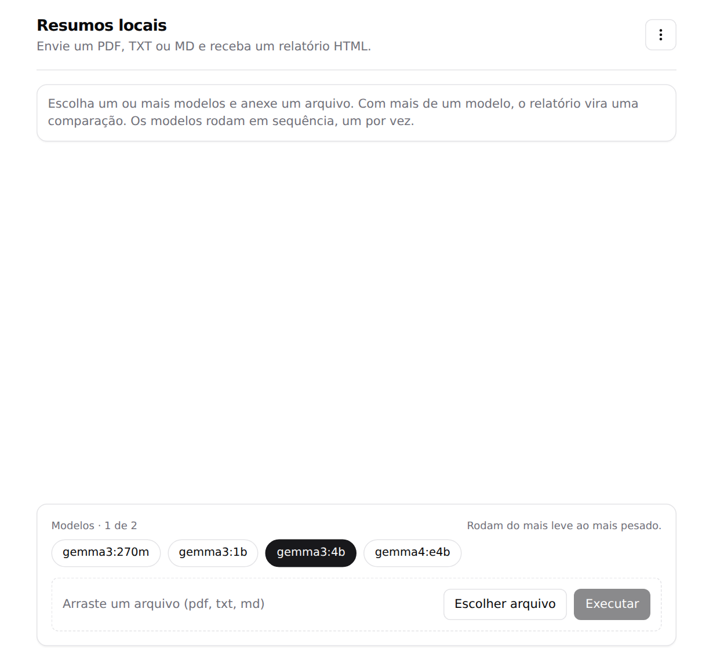
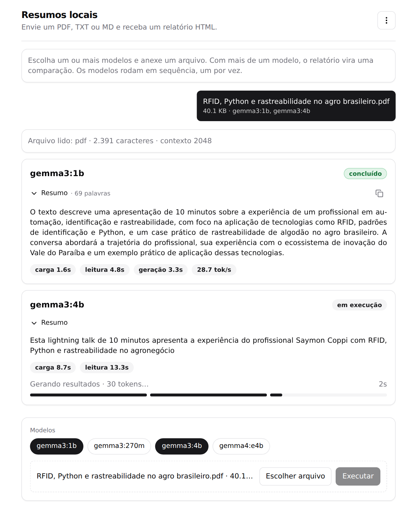
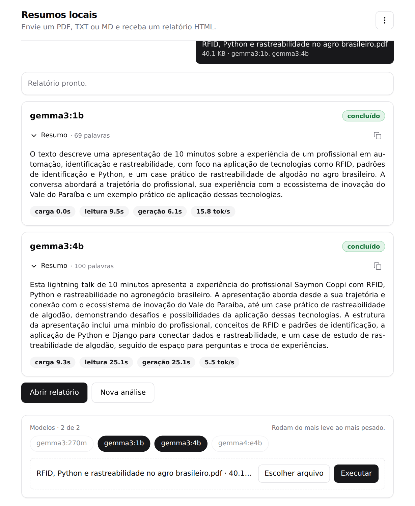
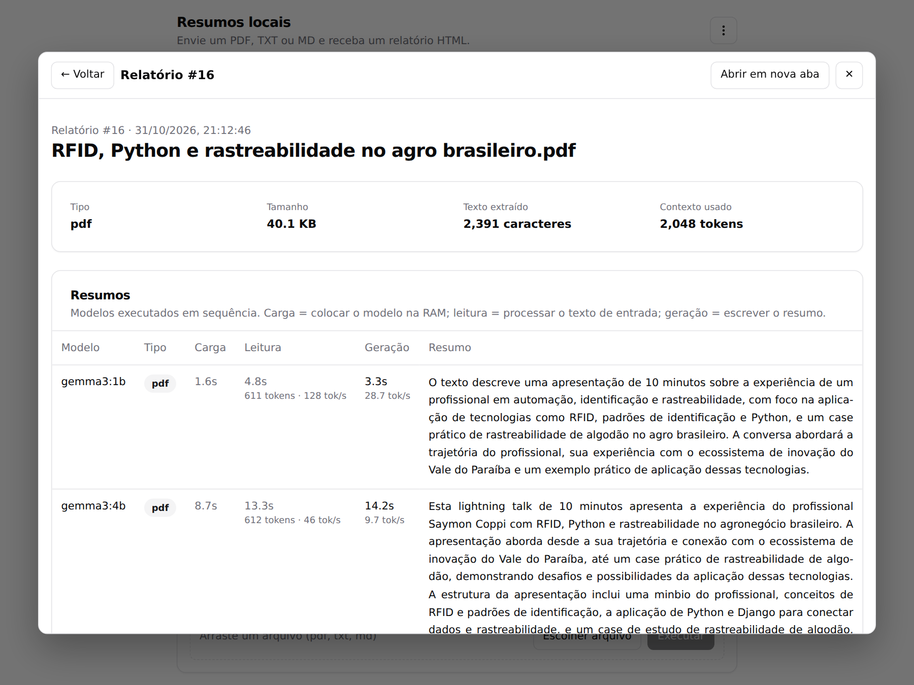
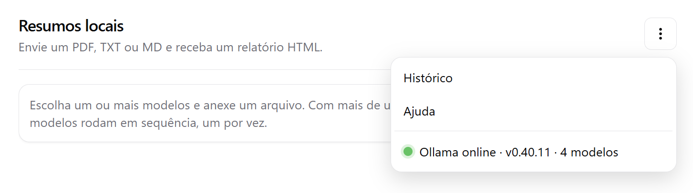
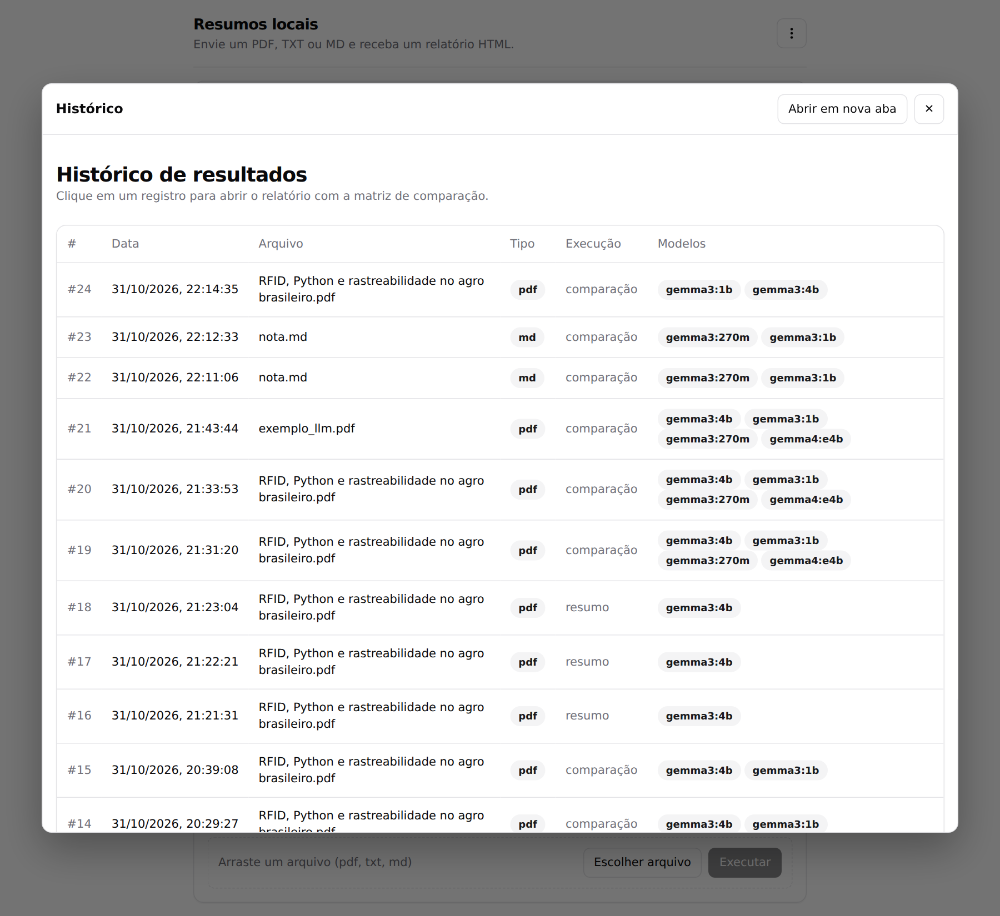
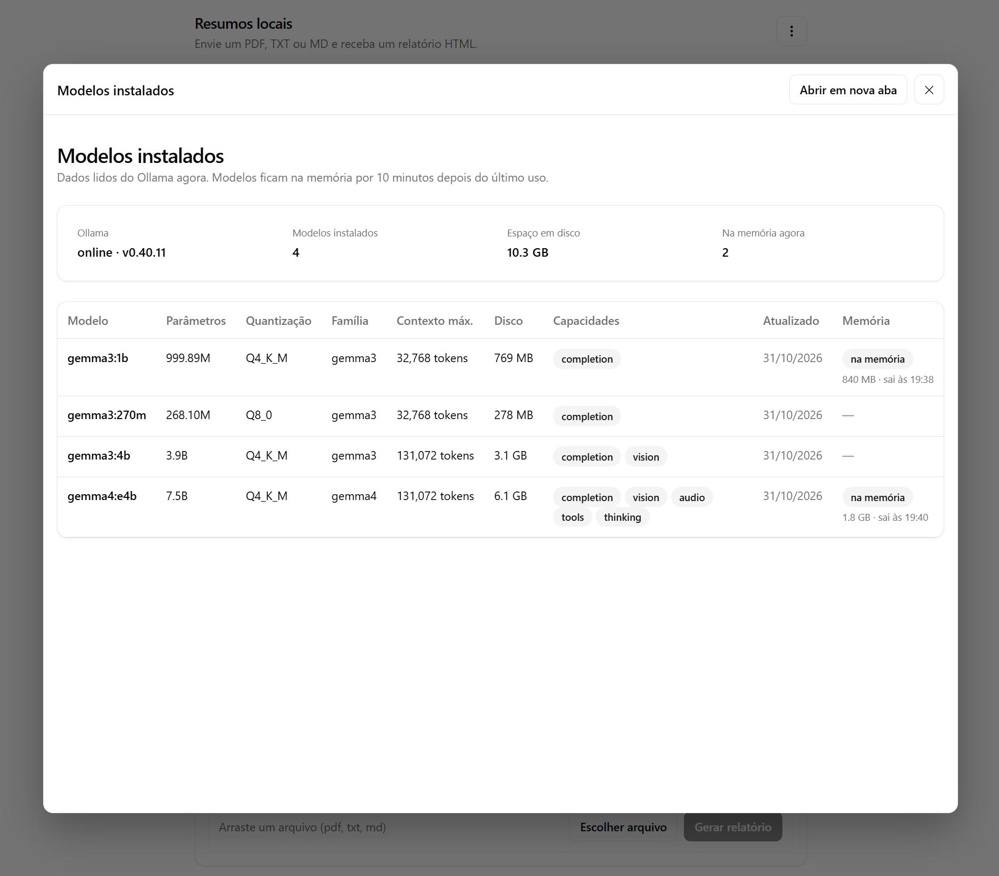
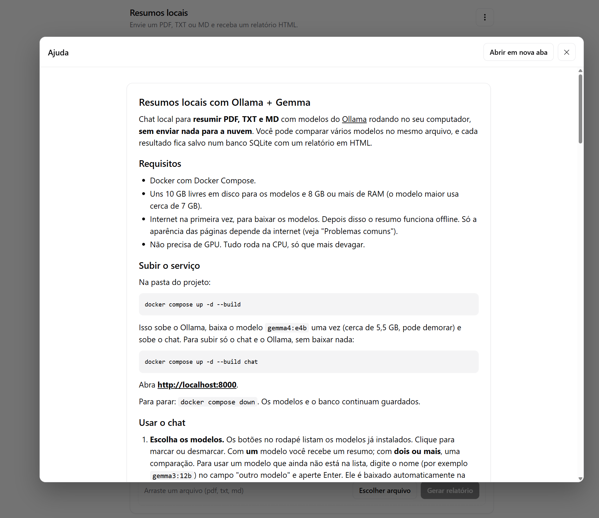

# Ollama + Gemma 4: rodando um LLM local e resumindo PDFs

Procedimentos mostrados na live: https://www.youtube.com/live/Xm-MSieGhko

> Este guia começa pelo passo a passo da live, feito no terminal (seções 1 a 4). O projeto evoluiu a partir dele: hoje existe um **chat web** que faz o mesmo resumo, compara vários modelos e guarda o histórico (seção 5). Para o manual completo do chat, veja o [README](../README.md). Os comandos abaixo devem ser executados na **pasta do projeto**, onde está o PDF de exemplo.

## Índice

1. [Instalar o Ollama](#1-instalar-o-ollama)
2. [Baixar e executar o modelo](#2-baixar-e-executar-o-modelo)
3. [Resumir um arquivo PDF](#3-resumir-um-arquivo-pdf)
   - [Dicas para o terminal](#dicas-para-o-terminal)
4. [Alternativa: rodar com Docker](#4-alternativa-rodar-com-docker)
   - [Subir o container (CPU)](#subir-o-container-cpu)
   - [Com GPU NVIDIA](#com-gpu-nvidia)
   - [Executar o modelo](#executar-o-modelo)
   - [Resumir um PDF com o container](#resumir-um-pdf-com-o-container)
   - [Docker Compose](#docker-compose)
5. [Do terminal ao chat: o projeto completo](#5-do-terminal-ao-chat-o-projeto-completo)
   - [Subir o chat](#subir-o-chat)
   - [Gerar um resumo ou uma comparação](#gerar-um-resumo-ou-uma-comparação)
   - [Menu: histórico, ajuda e modelos instalados](#menu-histórico-ajuda-e-modelos-instalados)
   - [O que o chat faz além do comando do terminal](#o-que-o-chat-faz-além-do-comando-do-terminal)
   - [Desempenho na CPU](#desempenho-na-cpu)
6. [Troubleshooting](#6-troubleshooting)
7. [Observações](#7-observações)

## 1. Instalar o Ollama

```bash
curl -fsSL https://ollama.com/install.sh | sh
```

Flags do `curl`: `-f` falha em erros HTTP, `-s` silencioso, `-S` mostra erros mesmo no modo silencioso, `-L` segue redirecionamentos.

> Dica: o script é executado direto via `sh`. Se preferir, baixe e leia antes de executar.

## 2. Baixar e executar o modelo

```bash
ollama run gemma4:e4b
```

Na primeira execução o modelo é baixado; depois abre um chat interativo no terminal. Para sair, use `/bye`.

## 3. Resumir um arquivo PDF

Instale o `poppler-utils`, que fornece o `pdftotext`:

```bash
sudo apt install poppler-utils
```

Extraia o texto do PDF e envie ao modelo via pipe:

```bash
pdftotext "RFID, Python e rastreabilidade no agro brasileiro.pdf" - | ollama run gemma4:e4b "Resuma o texto recebido:"
```

Como funciona:

- `pdftotext arquivo.pdf -` converte o PDF em texto e escreve na saída padrão (`-`).
- `|` repassa esse texto como entrada ao `ollama run`.
- A string final é o prompt; o texto do PDF vem junto como contexto.

O nome do arquivo tem espaços e vírgula, por isso precisa ficar entre aspas. Para outro PDF, troque o nome e ajuste o prompt (ex.: `"Liste os pontos principais em tópicos:"`).

### Dicas para o terminal

O comando acima funciona, mas o Gemma 4 imprime o **raciocínio** antes da resposta (o bloco `Thinking...`) e, se você redirecionar a saída para um arquivo, as palavras podem sair quebradas ou repetidas nas quebras de linha. Duas opções do `ollama run` resolvem:

```bash
pdftotext "RFID, Python e rastreabilidade no agro brasileiro.pdf" - | ollama run --hidethinking --nowordwrap gemma4:e4b "Resuma o texto recebido, sempre em português. Responda somente com o resumo, sem saudações, perguntas ou comentários finais."
```

- `--hidethinking` esconde o raciocínio e mostra só a resposta.
- `--nowordwrap` desliga a quebra automática de linha do terminal.
- O prompt mais específico evita saudações ("Olá!"), respostas em inglês e perguntas no final ("Quer que eu detalhe?"), que modelos menores costumam acrescentar.

O chat da seção 5 aplica tudo isso por padrão.

## 4. Alternativa: rodar com Docker

Útil para não instalar o Ollama direto no sistema.

### Subir o container (CPU)

```bash
docker run -d --name ollama \
  -v ollama:/root/.ollama \
  -p 11434:11434 \
  ollama/ollama
```

- `-v ollama:/root/.ollama` cria um volume para que os modelos baixados persistam.
- `-p 11434:11434` expõe a API do Ollama em `localhost:11434`.

### Com GPU NVIDIA

Requer o [NVIDIA Container Toolkit](https://docs.nvidia.com/datacenter/cloud-native/container-toolkit/latest/install-guide.html) instalado.

```bash
docker run -d --gpus=all --name ollama \
  -v ollama:/root/.ollama \
  -p 11434:11434 \
  ollama/ollama
```

### Executar o modelo

```bash
docker exec -it ollama ollama run gemma4:e4b
```

### Resumir um PDF com o container

O `pdftotext` roda no host e o texto é enviado ao container pelo pipe (`-i` mantém o stdin aberto, sem `-t`):

```bash
pdftotext "RFID, Python e rastreabilidade no agro brasileiro.pdf" - | docker exec -i ollama ollama run gemma4:e4b "Resuma o texto recebido:"
```

### Docker Compose

A versão mínima, só com o Ollama:

```yaml
services:
  ollama:
    image: ollama/ollama
    container_name: ollama
    ports:
      - "11434:11434"
    volumes:
      - ollama:/root/.ollama
    restart: unless-stopped

volumes:
  ollama:
```

```bash
docker compose up -d
docker compose exec ollama ollama run gemma4:e4b
```

O `docker-compose.yml` do projeto (na raiz) vai além dessa versão mínima e tem **três serviços**:

| Serviço | Função |
|---|---|
| `ollama` | O servidor do Ollama, com *healthcheck* (só fica "saudável" quando responde), um modelo por vez na memória (`OLLAMA_MAX_LOADED_MODELS=1`) e um bloco de GPU NVIDIA comentado, pronto para descomentar. |
| `pull-model` | Baixa o `gemma4:e4b` uma vez e encerra. Se o modelo já existe, termina na hora. |
| `chat` | O chat web, em `http://localhost:8000`. Fala com o Ollama pela rede interna do Compose. |

> No WSL2, a GPU só fica disponível no container se o Docker estiver configurado com suporte a GPU (Docker Desktop com integração WSL ou NVIDIA Container Toolkit).

## 5. Do terminal ao chat: o projeto completo

O comando da seção 3 resume **um** arquivo com **um** modelo e a resposta some quando o terminal fecha. O chat acrescenta o que faltava para comparar modelos de forma séria: guarda cada resultado, mede os tempos e mostra tudo lado a lado.

### Subir o chat

Na pasta do projeto:

```bash
docker compose up -d --build
```

Isso sobe o Ollama, baixa o `gemma4:e4b` (cerca de 5,5 GB na primeira vez) e sobe o chat. Para subir só o chat e o Ollama, sem baixar nada, use `docker compose up -d --build chat`. Depois abra **http://localhost:8000**. Para parar, `docker compose down`; os modelos e o histórico continuam guardados.

### Gerar um resumo ou uma comparação



Na tela inicial, escolha os **modelos** (botões de baixo), anexe o arquivo (PDF, TXT ou MD, até 20 MB) e clique em **Executar**. Com um modelo você recebe um resumo; com dois ou mais, uma comparação. Para usar um modelo que ainda não está instalado, digite o nome no campo "outro modelo" e aperte Enter: ele é baixado sozinho.



Cada modelo roda **um de cada vez** e tem um cartão com o resumo sendo escrito ao vivo. O rodapé do cartão mostra a **etapa atual** (*Carregando modelo*, *Executando leitura*, *Gerando resultados*), um cronômetro e uma barra dividida em três trechos, um para cada etapa. Os **pills de tempo** (carga, leitura, geração e tokens por segundo) aparecem conforme cada etapa termina, e o selo do cartão vira **concluído** (verde) no fim. Na captura acima, o primeiro modelo já concluiu e o segundo está nas etapas iniciais.

> As capturas desta seção foram feitas com uma versão anterior da tela: os pills apareciam todos de uma vez no fim da análise, o resumo não era recolhível e o botão principal se chamava *Gerar relatório*.



Passe o mouse sobre um pill para ver um tooltip que explica o que ele mede. **Carga** é colocar o modelo na memória, **leitura** é o modelo processar o texto de entrada e **geração** é escrever o resumo (com a velocidade em tokens por segundo). O resumo fica dentro do cartão e pode ser **recolhido** pelo botão *Resumo*; depois de concluído, um ícone permite **copiar** o texto. Os botões **Abrir relatório** e o verde **Nova análise** aparecem abaixo.



O relatório mostra os dados do arquivo e a **matriz de comparação**: uma linha por modelo, com tipo, os três tempos e o resumo completo.

### Menu: histórico, ajuda e modelos instalados

O botão de três pontinhos (⋮) abre o menu:



- **Histórico** e **Ajuda** abrem numa janela (modal) sobre o chat.
- O item de baixo mostra o **status do Ollama** (bolinha verde = online, vermelha = offline) e se atualiza sozinho a cada 10 segundos.



O **Histórico** lista todas as execuções, da mais recente para a mais antiga. Clicar numa linha abre o relatório daquele registro dentro da mesma janela.



Clicar no status **online** abre os **modelos instalados**: parâmetros, quantização, contexto máximo, capacidades (`completion`, `vision`, `thinking`...), tamanho em disco e quais estão **na memória** agora. Dá para ver, por exemplo, que o `gemma4:e4b` tem 7,5 bilhões de parâmetros e ocupa 6,1 GB, enquanto o `gemma3:1b` ocupa 769 MB.



A **Ajuda** é o próprio [README](../README.md), renderizado dentro do chat.

### O que o chat faz além do comando do terminal

| No terminal (seção 3) | No chat |
|---|---|
| Só PDF. | PDF, TXT e MD, com o tipo detectado automaticamente e aviso quando o arquivo não serve (PDF escaneado, vazio, binário, grande demais). |
| Um modelo por vez; você compara de cabeça. | Vários modelos no mesmo arquivo, em sequência, numa matriz única. |
| Sem medição. | Tempo de carga, leitura e geração por modelo, e tokens por segundo. |
| O resultado some quando o terminal fecha. | Cada execução fica salva no SQLite (`outputs/resumos.db`) e aparece no histórico. |
| Contexto padrão de 4096 tokens: textos maiores são cortados **sem aviso**. | O contexto é ajustado ao tamanho do texto (de 2048 a 16384 tokens), e o relatório avisa se o arquivo não coube. |
| Raciocínio e saudações no meio da resposta, a menos que você use as dicas da seção 3. | `temperature 0`, raciocínio desligado e prompt que pede só o resumo, em português. |
| Baixar modelo é um comando à parte. | Basta digitar o nome do modelo; o chat baixa e mostra o progresso. |

Para consultar o banco sem instalar nada no host:

```bash
docker compose exec chat python -c "
import sqlite3
for row in sqlite3.connect('/outputs/resumos.db').execute(
    'SELECT run_id, model, round(gen_s,1), round(tok_s,1) FROM results'):
    print(row)"
```

### Desempenho na CPU

Sem GPU, a **carga** e a **leitura** do texto costumam pesar mais que a geração, principalmente nos modelos maiores. Nas capturas acima, o `gemma3:1b` levou menos de 20 segundos no total, e o `gemma4:e4b` passou de 100 segundos. O primeiro uso de um modelo paga a carga; depois ele fica 10 minutos na memória.

**Por que a leitura é mais lenta no modelo maior, se o texto já foi extraído?** Porque "ler" não é copiar o texto: o modelo passa cada token por todas as suas camadas para montar a sua memória de atenção. É cálculo, e cresce com o tamanho do modelo. Com o mesmo texto (~575 tokens) e o modelo já carregado, o `gemma3:1b` leu a 71 tok/s e o `gemma4:e4b` a 15 tok/s. O resultado dessa leitura é próprio de cada modelo, então não é reaproveitado pelo seguinte. Só repetir exatamente o mesmo prompt no mesmo modelo, ainda carregado, torna a leitura quase instantânea (menos de meio segundo).

**Memória:** manter vários modelos carregados ao mesmo tempo piora a leitura. Com os três modelos abertos (2,3 GB de RAM livre), o `gemma4:e4b` leu a 26 tok/s; com só ele (6,5 GB livres), a 42 tok/s. Por isso o `docker-compose.yml` usa `OLLAMA_MAX_LOADED_MODELS=1`: o Ollama descarrega o modelo anterior ao carregar o próximo.

Medições feitas num notebook Intel i7-1185G7 (4 núcleos, 8 threads), sem GPU, com 20 GB de RAM no WSL2. Os seus números vão variar, e o mesmo teste oscilou até cerca de 15% entre rodadas:

| Ajuste testado | Resultado |
|---|---|
| Padrão do Ollama (4 threads, uma por núcleo físico) | **O melhor.** Geração de 6 a 7 tok/s no `gemma4:e4b`. |
| Usar as 8 threads | **Pior:** a geração caiu de ~7 para ~2 tok/s. Não aumente o número de threads. |
| Um modelo por vez na memória (`OLLAMA_MAX_LOADED_MODELS=1`) | **Melhor:** libera RAM e cache de disco. Com os três modelos carregados, a leitura do `gemma4:e4b` foi 26 tok/s; com só ele, 42 tok/s. Já é o padrão do `docker-compose.yml`. |
| `OLLAMA_FLASH_ATTENTION=1` | Pior: a leitura caiu de ~31 para ~25 tok/s no `gemma3:4b`. |
| GPU integrada Intel | Inviável no WSL2 com o Ollama em container: o pacote Mesa do Ubuntu não traz o driver `dzn` e não existe `/dev/dri`. |

Na prática: o `gemma3:4b` costuma ser o melhor equilíbrio entre tempo e qualidade, e o `gemma4:e4b` é o mais completo e o mais lento. O `gemma3:270m` é rápido, mas **não é confiável** para resumir.

## 6. Troubleshooting

### `ollama: command not found` após instalar
Abra um novo terminal ou rode `hash -r` / `source ~/.zshrc`. Confirme com `which ollama`.

### `could not connect to ollama server` / `connection refused`
O servidor não está rodando. Em sistemas com systemd:

```bash
sudo systemctl status ollama
sudo systemctl start ollama
```

No WSL2 sem systemd habilitado, inicie manualmente em outro terminal:

```bash
ollama serve
```

Para testar a API: `curl http://localhost:11434` (deve responder `Ollama is running`).

### O chat mostra "Ollama offline" (bolinha vermelha)
O chat não está conseguindo falar com o Ollama. Confira os containers e os logs:

```bash
docker compose ps
docker compose logs ollama
```

O serviço `ollama` precisa estar `healthy`. Se ele acabou de subir, aguarde alguns segundos: o status se atualiza sozinho. Se a lista de modelos do chat estiver vazia, recarregue a página depois que o Ollama voltar.

### O chat recusa o arquivo
As mensagens dizem o motivo: tipo diferente de PDF, TXT ou MD; PDF escaneado (sem texto; veja "O resumo vem vazio" abaixo); arquivo vazio; arquivo binário com extensão de texto; ou maior que 20 MB.

### `model "gemma4:e4b" not found` / erro no pull
- Verifique o nome e a tag exatos na biblioteca: https://ollama.com/library
- Baixe explicitamente: `ollama pull gemma4:e4b` (ou `docker exec ollama ollama pull gemma4:e4b`)
- Liste o que já está instalado: `ollama list`

### Download lento ou interrompido
O `pull` retoma de onde parou; rode o comando de novo. Confira também o espaço em disco (`df -h`), pois modelos ocupam vários GB. No chat, o download aparece como barra de progresso no cartão do modelo.

### Falta de memória / modelo muito lento
- Feche outros programas pesados e confira a RAM livre (`free -h`).
- No WSL2, a memória é limitada pelo `.wslconfig` (em `C:\Users\<usuario>\.wslconfig`):

  ```ini
  [wsl2]
  memory=12GB
  ```

  Depois rode `wsl --shutdown` no PowerShell e reabra o WSL. Atenção: isso reinicia **todos** os containers do Docker no WSL.
- Sem GPU o modelo roda na CPU e fica bem mais lento. Veja em qual processador ele está: `ollama ps` (mostra `100% CPU`).
- Não force mais threads do que o padrão do Ollama; veja a tabela em [Desempenho na CPU](#desempenho-na-cpu).
- Confira quantos modelos estão carregados com `ollama ps` e a RAM disponível com `free -h`. Vários modelos carregados ao mesmo tempo (cada um fica 10 minutos) esgotam a memória e deixam a leitura mais lenta. Para descarregar um modelo na hora: `curl localhost:11434/api/generate -d '{"model":"gemma4:e4b","keep_alive":0}'`.

### GPU não é usada no Docker
- Confirme que o container foi criado com `--gpus=all`.
- Teste o acesso: `docker exec -it ollama nvidia-smi`.
- Se falhar, reinstale/configure o NVIDIA Container Toolkit e reinicie o Docker.
- Em notebooks sem placa NVIDIA (só GPU integrada), não há aceleração: o Ollama roda na CPU.

### `port is already allocated` (11434 ou 8000)
Já existe um Ollama (porta 11434) ou outro serviço (porta 8000, a do chat) ocupando a porta, seja uma instalação local ou outro container. Pare-o ou mapeie outra porta no host, ex.: `-p 11435:11434`, ou, no `docker-compose.yml`, troque o número da esquerda em `127.0.0.1:8000:8000`.

### `pdftotext: command not found`
Instale o pacote: `sudo apt install poppler-utils`. (No chat isso não é necessário: o `pdftotext` já vem dentro da imagem.)

### O resumo vem vazio ou sem sentido
Provavelmente o PDF é escaneado (sem texto). Confira a extração antes de enviar ao modelo:

```bash
pdftotext arquivo.pdf - | head
```

Se sair vazio, use OCR (ex.: `ocrmypdf`) antes do `pdftotext`. O chat detecta esse caso e avisa "PDF sem texto extraível".

### `sudo apt` não funciona
O `apt` é específico de Debian/Ubuntu. Em Fedora use `sudo dnf install poppler-utils`; em Arch, `sudo pacman -S poppler`; no macOS, `brew install poppler`.

## 7. Observações

- PDFs escaneados (só imagem) não têm texto extraível pelo `pdftotext`; seria necessário OCR.
- Documentos muito longos podem exceder a janela de contexto do modelo. No terminal, o padrão do Ollama é de 4096 tokens e o excesso é cortado sem aviso. O chat ajusta o contexto ao texto (até 16384 tokens) e avisa no relatório quando o arquivo não cabe.
- Resumos de modelos pequenos podem errar detalhes (como o gênero de uma pessoa) ou inventar trechos. Compare vários modelos e confira o resultado com o texto original.
- Os dados ficam todos na sua máquina: nada é enviado para a nuvem. Só a aparência das páginas do chat depende da internet (bibliotecas carregadas de CDN).
